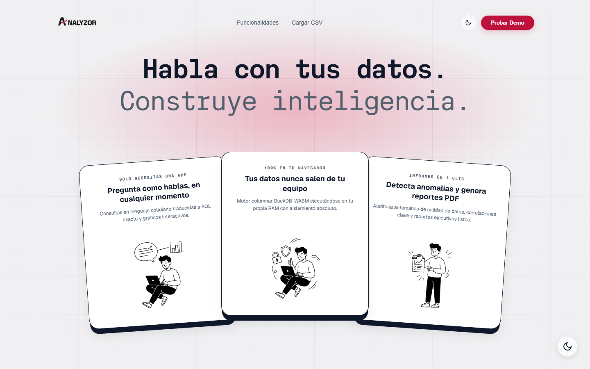
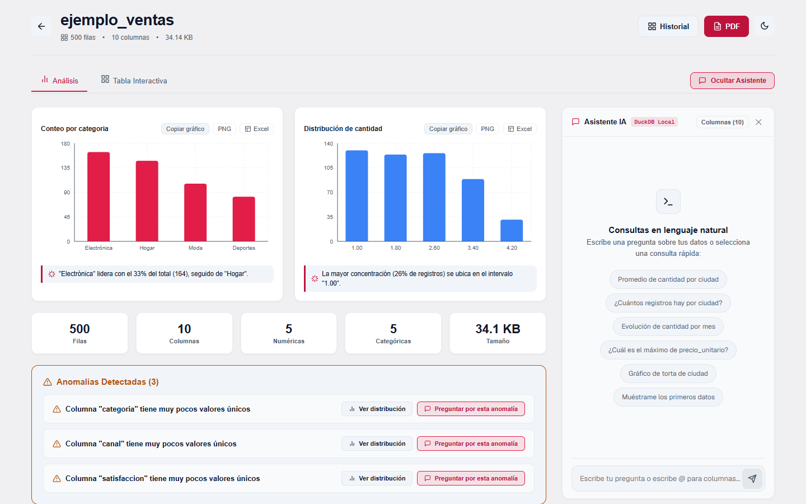
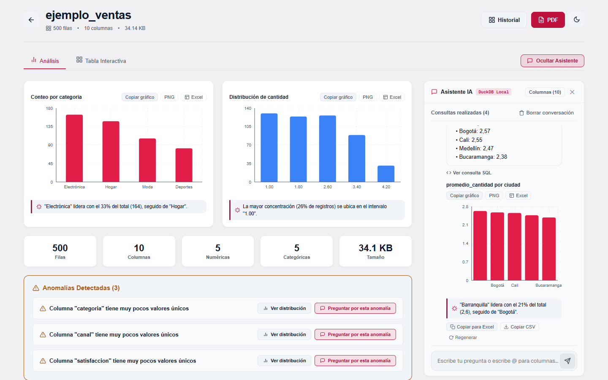
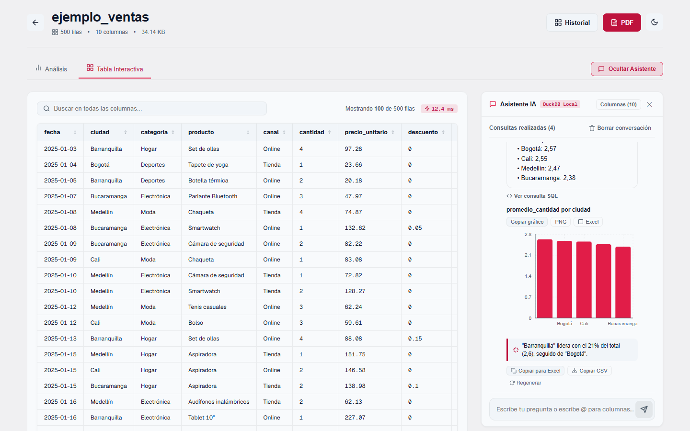

# Analyzor

**Terminal analítica visual impulsada por IA y DuckDB-WASM.** Sube un archivo CSV o pega tus datos directo del portapapeles (`Ctrl + V`), formula preguntas en lenguaje natural y obtén respuestas inmediatas con gráficos interactivos, tablas dinámicas y reportes ejecutivos en PDF. Todo el procesamiento de datos corre en la memoria RAM de tu navegador: tus archivos nunca se envían a ningún servidor externo.

**Demo en vivo: [analyzor.vercel.app](https://analyzor.vercel.app)** · pulsa *Probar Demo* para explorar el entorno en un clic con datos de ejemplo.




## Funcionalidades principales

### Carga y previsualización sin fricción
- **Pegado directo del portapapeles (`Ctrl + V`):** Copia celdas o tablas desde Excel o Google Sheets y pégalas directamente en Analyzor. El sistema detecta y parsea los datos en memoria al instante sin obligar a guardar archivos en disco.
- **Micro-inspección previa en Dropzone:** Al soltar o seleccionar un archivo, un micro-resumen animado en 200 ms detecta filas y columnas antes de iniciar el análisis.
- **Sandbox interactivo en la portada:** Prueba consultas, correlaciones, evolución temporal y gráficos interactivos en vivo desde la misma landing page sin necesidad de registrarte ni cargar datos.

### Dashboard analítico en Split View
- **Entorno de trabajo simultáneo:** Visualiza métricas, gráficos automáticos y tablas al mismo tiempo que interactúas con el Asistente IA lateral (colapsable a pantalla completa o accesible vía drawer táctil en dispositivos móviles).
- **Tabla interactiva DuckDB en tiempo real:** Ordena miles de filas por cualquier columna en menos de 3 ms, filtra al instante con búsqueda global multicriterio y examina nulos con badges discretos.
- **Detección de anomalías con Click-To-Action:** Identifica filas con valores nulos o atípicos y accede a acciones directas de 1 clic para aislar los registros afectados o consultar a la IA sobre la causa.
- **Telemetría local en el navegador:** Indicador en tiempo real de milisegundos de cómputo y verificación de privacidad (0 bytes transmitidos a servidores externos).

### Chat analítico inteligente
- **Autocompletado con `@` para columnas:** Escribe `@` en el campo de consulta para desplegar un menú inteligente con las columnas reales del dataset, evitando errores de tipeo.
- **Preguntas sugeridas 100% dinámicas:** Generadas automáticamente a partir de la estructura del dataset cargado (top por categorías, evolución temporal si hay fechas, comparaciones numéricas).
- **Acciones directas en cada respuesta:**
  - **Copiar gráfico en 1 clic:** Copia la visualización como imagen PNG al portapapeles para pegarla en Slack, Teams, Notion o presentaciones.
  - **Exportar vista de datos:** Copia tablas filtradas por la IA como TSV (para pegar en Excel) o CSV con un clic.
- **Explicación humana de gráficos:** Cada visualización incluye un resumen en prosa que sintetiza la conclusión clave del gráfico.
- **Protección y fallback automático:** Filtro estricto anti-alucinaciones que rechaza scripts de Python/matplotlib, extrayendo las sentencias SQL para garantizar visualizaciones interactivas nativas con Recharts en el navegador.

### Craftmanship y estética visual
- **Paleta carmesí refinado (`#e11d48`):** Un tono maduro y sereno para botones primarios, badges y acentos interactivos, reservando el rojo exclusivamente para alertas críticas y métricas focales.
- **Tipografía numérica tabular (`tabular-nums`):** Números y porcentajes con ancho uniforme en toda la plataforma para evitar desalineaciones en tablas y métricas dinámicas.
- **Bordes y elevaciones limpias:** Bordes sutiles de 1 px (`rgba(0,0,0,0.06)` en claro, `rgba(255,255,255,0.08)` en oscuro) y sombras de alta definición.
- **100% libre de emojis:** Interfaz visual sobria con iconografía vectorial SVG profesional.
- **Diseño responsive integral:** Optimizado para pantallas pequeñas (móviles sin desbordes horizontales) y monitores ultrawide/4K (hasta 1780 px sin espacios vacíos).

| Portada editorial & Sandbox interactivo | Split View del Dashboard & Anomalías |
|---|---|
|  |  |

| Terminal analítica & Gráficos con IA | Tabla interactiva DuckDB (< 3 ms) |
|---|---|
|  |  |

## Cómo funciona

Los datos **nunca salen de tu navegador**. El análisis analítico y las consultas SQL corren localmente con DuckDB compilado a WebAssembly. La IA externa se utiliza exclusivamente para traducir tu pregunta en lenguaje natural a una consulta SQL de lectura, enviando únicamente el **esquema de nombres de columnas y hasta 5 filas de muestra**.

```
Navegador (React + DuckDB-WASM)                        Cloudflare Worker          Groq
 ├─ DuckDB-WASM: ejecución SQL y perfilado local    ┐
 ├─ IndexedDB: almacenamiento local de datasets     ├─ POST /api/ask, /api/answer ─▶ gpt-oss
 ├─ Recharts + jsPDF: gráficos y reportes en cliente │   · la API key vive solo en el Worker
 └─ Motor de reglas local (fallback si no hay IA)   ┘   · limitación de ráfagas y cuota diaria
                                                        · 0 datos del archivo enviados a la nube
```

- **Seguridad del SQL:** Solo se ejecutan sentencias de lectura `SELECT` validadas por un guardia estricto, sin acceso a funciones de red ni sistema de archivos.
- **Respaldo local sin IA:** Si la conexión a la IA no está disponible o se agota la cuota, el motor de reglas interno resuelve consultas de agregación, promedios, rankings, filtros y gráficos de forma autónoma.
- **Sin servidores backend:** Sin base de datos centralizada, sin costo de infraestructura fija y sin arranque en frío.

## Estructura del proyecto

```
frontend/            React 19 + Vite 8
  src/engine/        Motor local: DuckDB-WASM, perfilado estadístico, chat, PDF, IndexedDB
  src/api/           Adaptadores que exponen el motor con la interfaz de API de la UI
  src/components/    Componentes interactivos: Split View, Chat, Tabla DuckDB, Gráficos
  src/pages/         Landing editorial y Dashboard analítico
  scripts/           Automatización de capturas oficiales con Puppeteer
worker/              Cloudflare Worker: proxy seguro de IA, validación y control de cuotas
docs/screenshots/    Capturas oficiales del README
```

## Desarrollo local

Requisitos: Node.js 20+.

```bash
cd frontend
npm install
npm run dev          # Inicia en http://localhost:5173
npm test             # Ejecuta la suite de pruebas unitarias (Vitest)
npm run lint         # Verificación de linter (ESLint)
```

Sin configuración adicional, la aplicación opera al 100% utilizando el motor local de DuckDB y reglas. Para activar la traducción con IA en entorno local:

```bash
cd worker
npm install
npx wrangler dev --var GROQ_API_KEY:<tu-clave-groq>     # Inicia en http://localhost:8787

# En frontend/.env.local:
# VITE_LLM_URL=http://localhost:8787
```

Para regenerar las capturas oficiales de la documentación:

```bash
cd frontend
npm run screenshots
```

## Despliegue en producción

**1. Worker de IA (Cloudflare Workers)**

```bash
cd worker
npx wrangler login
npx wrangler secret put GROQ_API_KEY
npx wrangler deploy
```

Configura `ALLOWED_ORIGINS` en `wrangler.toml` con la URL de tu frontend en producción.

**2. Frontend (Vercel o Cloudflare Pages)**

- Directorio raíz: `frontend`
- Comando de build: `npm run build`
- Directorio de salida: `dist`
- Variable de entorno: `VITE_LLM_URL` con la URL de tu Cloudflare Worker desplegado.

## Privacidad y almacenamiento

- Los datasets residen exclusivamente en el almacenamiento local del navegador (`IndexedDB`).
- Límite recomendado: hasta 200 MB por archivo CSV (procesado mediante streaming en DuckDB-WASM).
- Al limpiar la memoria caché o datos del navegador, los datasets locales se eliminan por completo.
